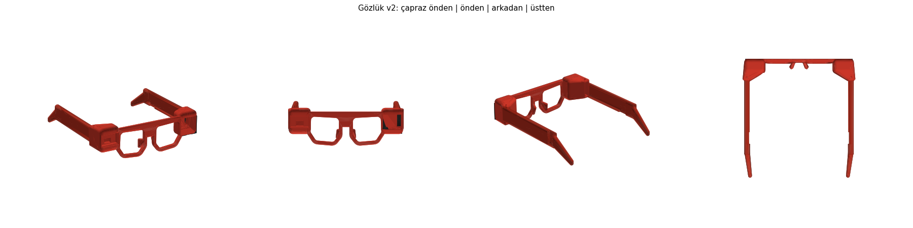
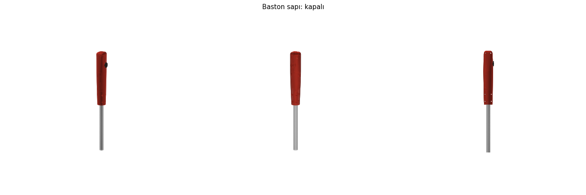

# Gözlük v2 ve Akıllı Baston

Bu klasörde 3D yazıcıyla basılacak parçalar ve onları üreten Python kodları var.

- `stl/`: Basılmaya hazır dosyalar. Hepsi baskı yönüne çevrilmiş durumda.
- `onizleme/`: Parçaların görüntüleri.
- `gozluk.py`, `baston.py`: Ölçüler bu dosyaların başında. Değiştirip yeniden üretebilirsiniz.

```
pip install manifold3d numpy matplotlib
python3 gozluk.py
python3 baston.py
```

Ölçü uyarısı: Kamera Modülü 3 ölçüleri resmi çizimden alındı. Sensör kartı ve baston borusu ölçüleri tahmin. Önce `test_kamera_yuvasi.stl` dosyasını basın, yaklaşık 15 dakika sürer. Kart rahat oturmuyorsa `TOLERANS` değerini artırın. Sensör kartının ölçülerini kumpasla alıp `gozluk.py` içindeki `SENSOR_*` değerlerine yazın. Baston borusunun çapını ölçüp `baston.py` içindeki `BORU_CAP` değerine yazın.

## Gözlük v2



Eski tasarıma göre değişenler:

| Sorun | Çözüm |
|---|---|
| Şerit kablo kameradan dışarı sarkıyordu | Kamera sol köşedeki yuvada duruyor. Kablo ön çerçeveyi hiç geçmeden sol sapın içindeki kanala giriyor ve kulağın önünde sapın altından çıkıyor |
| Sensör kabloları açıktaydı | Sensör sağ köşede, kabloları sağ sapın kanalından geçiyor |
| Kamera düz bakıyordu | Kamera 12° aşağı bakıyor ve 1 ila 3 m ilerideki basamağı görüyor. Sensör düz bakıyor, çünkü görevi bastonun göremediği baş ve göğüs hizası |
| Yan yana iki düz plaka | Köşe yuvaları akıllı gözlüklerdeki gibi. Arkaları başın tarafından daralıyor, yüze değmiyor |

### Parçalar ve baskı

| Dosya | Adet | Baskı yönü | Not |
|---|---|---|---|
| `gozluk_on.stl` | 1 | Ön yüz tablada | Destek gerekmez |
| `gozluk_on_kapak_kamera.stl` | 1 | Ön yüz tablada | Siyah basılırsa şık durur |
| `gozluk_on_kapak_sensor.stl` | 1 | Ön yüz tablada | Siyah |
| `gozluk_sap_sol.stl`, `gozluk_sap_sag.stl` | 1'er | Dış yüz tablada, kanal yukarı | Destek gerekmez |
| `gozluk_kapak.stl` | 2 | Düz | Kanal kapağı |
| `test_kamera_yuvasi.stl` | 1 | Ön yüz tablada | Önce bunu basın |

Önerilen ayarlar:
- **Malzeme:** PLA, ya da yazın araba gibi sıcak yerlerde kalacaksa PETG.
- **Dilimleme:** 0,2 mm katman, 3 duvar, %20 dolgu.

### Montaj

1. **Kamera:** Kamera kartını şerit kablosu takılı hâlde sol yuvaya önden yerleştirin. Kablo yuvanın arkasından sapa doğru geçsin. Ön kapağı bastırarak takın. Gevşekse kenarına bir damla yapıştırıcı sürün.
2. **Sensör:** Kartı sağ yuvaya takın ve kapağını kapatın. Kabloları kartın arkasına lehimleyin, jumper uçları yuvaya sığmaz. Kart iki sıra pinliyse SCL ve SDA yazan sırayı kullanın.
3. **Saplar:** Sapları yuvaların arkasındaki yuvaya itin ve üstten birer M2 × 25 vidayla sabitleyin.
4. **Kablolar:** Şerit kablo kanalda dik durur. Kanalın sonunda 45° katlanarak alttaki yarıktan çıkar. Kanal kapaklarını bastırarak takın.
5. **Bele iniş:** Kulağın arkasından inen kabloları örgülü kablo kılıfıyla bele kadar götürün.

### Gerekenler

| Parça | Not |
|---|---|
| 2 × M2 × 25 vida | Sapları tutar |
| 1 m CSI şerit kablo | Kamera ile bel arasındaki mesafe için. Daha sağlam bir son sürüm için "CSI to HDMI uzatma kiti" ile şerit kablo yerine yuvarlak HDMI kablo kullanılabilir |
| 4 damarlı ince silikon kablo | Sensör için, yaklaşık 1 m |
| Örgülü kablo kılıfı | 8 ila 10 mm, yaklaşık 1 m |

## Akıllı Baston



Hazır, katlanabilir bir beyaz bastonun en üst borusuna takılan bir sap.
- **Takma:** Bastonun lastik sapı çıkarılır ve boru bu sapın altındaki yuvaya girer.
- **Sabitleme:** İki yarımı birleştiren dört M3 vida boruyu kelepçe gibi sıkar.
- **Baskı:** Yarımlar birleşme yüzü tablada basılır ve destek gerekmez. Ter ve darbeye dayanıklı olduğu için PETG önerilir.

### Parçalar ve baskı

| Dosya | Adet | Baskı yönü |
|---|---|---|
| `baston_sap_sol.stl`, `baston_sap_sag.stl` | 1'er | Birleşme yüzü tablada, destek gerekmez |
| `baston_dugme_basligi.stl` | 1 | Pim altta. Diskin altına küçük bir destek açın |

### İçindekiler

| Parça | Ölçü | Görevi |
|---|---|---|
| Seeed XIAO ESP32C3, harici antenli | 21 × 17,5 mm | Bluetooth LE. Pil şarj devresi ve USB-C kartın üstünde |
| LiPo pil, yaklaşık 1000 mAh, örn. 102050 | ~10 × 20 × 50 mm | Tahminen 2 ila 3 gün kullanım |
| 2 × düz titreşim motoru | 10 × 3 mm | Sol ve sağ duvarda, avuç altında |
| 2 × AO3400 MOSFET (ya da 2N2222 + 1 kΩ) ve 2 × 1N4148 | | Motor sürücüleri |
| 12 × 12 mm tactile düğme | | Başparmak altında. Başlığın üstünde kabartma nokta var |
| MPU-6050 (GY-521) | 21 × 16 mm | Yürüme ve düşme algılama |
| 12 mm pasif buzzer | | "Bastonum nerede" ve düşme sesi |
| Mini sürgü anahtar (SS12D00) | | Ana güç. Yanlışlıkla kapanmasın diye alt yüzde |
| 2 × 220 kΩ direnç | | Pil voltajı ölçümü |
| 5 × M3 × 16 vida ve somun | | Gövdeyi birleştirir |
| Bilek askısı | | Tepedeki delikten geçer |

### Kablolama (XIAO ESP32C3)

```
D1  ── düğme ── GND                 (dahili pull-up)
D2  ── MOSFET ── sol motor           (motorun iki ucuna ters yönde 1N4148)
D3  ── MOSFET ── sağ motor
D4  ── MPU-6050 SDA
D5  ── MPU-6050 SCL
D10 ── buzzer ── GND
A0  ── 220k/220k bölücü ── BAT+     (pil voltajı)
BAT+/BAT- (kartın altındaki pedler) ── anahtar ── LiPo
```

## Baston ile gözlük nasıl birlikte çalışır

Baston Bluetooth LE ile Pi'ye bağlanır. Böylece kullanıcının eli zaten bastonun üstündeyken gözlüğü kontrol edebilir ve uyarıları avucunda hisseder.

### Düğme

Gözlükteki tek düğme mantığının aynısı:

| Basış | İş |
|---|---|
| Kısa | "Önümde ne var?" Konuşma sürüyorsa önce susturur |
| Uzun, basılı tut | Soru sor, bırakınca cevap gelir |
| Çift | Son söyleneni tekrarla |

### Titreşim

| Durum | Desen |
|---|---|
| Çarpışmaya < 2 sn | İki motorda kısa darbeler, yaklaştıkça sıklaşır |
| Çarpışmaya < 1 sn, "Dur" | İki motorda 0,4 sn güçlü titreşim |
| Dinlemeye başladım | Bir kısa, hafif titreşim |
| Önemli olay (basamak, yaya geçidi) | Üç kısa titreşim. Ayrıntıyı gözlük söyler |
| Navigasyon (Aşama 4) | Sağa dön: sağ motor 2 darbe. Sola dön: sol motor 2 darbe |

### Hareket sensörü

- **Yürüme:** Baston sağa sola tarandığında kullanıcı yürüyor demektir. Gözlük duran kullanıcıya hiç tık vermez. Bu, baş çevirmekten gelen yanlış uyarıları da azaltır.
- **Düşme:** Ani bir darbeden sonra baston 2 saniye yerde hareketsiz kalırsa buzzer iki saniyede bir öter. Gözlük "Baston düştü, ses çıkarıyor" der. Düğmeye basınca susar.

### Diğer

- **"Bastonum nerede?":** Gemini'ye sorulur, baston 10 saniye öter.
- **Pil:** Baston dakikada bir pil seviyesini bildirir. %15'in altına inince gözlük bir kez "Baston pili azaldı" der.
- **Bağlantı kopması:** Gözlük kısa bir ton çalar. Engel uyarıları kulaklıktan tıkla devam eder.
- **Uyku:** Baston 10 dakika bağlantısız kalırsa uyur ve düğmeye basınca uyanır.

### Riskler

- **Bluetooth paylaşımı:** Pi 4'ün Bluetooth'u aynı anda hem kulaklığa hem bastona hizmet verecek. Bu genelde çalışır, ama kulaklık sesinde takılma olabilir. İlk iş bunu denemek gerekir.
- **Ölçüler:** Baston borusu ölçüsü markaya göre değişir, `BORU_CAP` değerini ölçerek girin.
